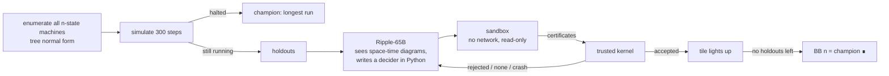

# NEVERHALT: proof of never

**Ripple-65B writes the programs; mathematics checks them.** Ripple writes halting-problem deciders. A
158-line trusted kernel (`neverhalt/kernel.py`) checks every certificate they produce, and each machine
proven to run forever lights up on a wall of space-time diagrams. A Busy Beaver value is proven only when
no holdout is left. Ripple is never trusted: a wrong certificate is rejected, a missing one leaves a dark
tile.

## Results: Ripple-65B Preview via OpenRouter, 13 Nov 2026

Every run is recorded in `runs/<run>/` (journal, the deciders Ripple wrote, certificates). Any run can be
re-verified from scratch, without the model and without the deciders: `python3 -m neverhalt check <run>`.

**Headline: BB(3) = 21 ∎, proven end to end by deciders Ripple wrote.** `python3 -m neverhalt check
bb3-scale-hints` enumerates all 5,415 three-state machines again: 1,772 halt (the longest after 21 steps)
and every one of the 3,643 others carries a kernel-accepted certificate that it never halts (526 cycle,
3,025 translated cycle, 92 closed-set). The last 37, the counters and bouncers, fell to 70 parallel Ripple
samples in 229 s for $0.06; sample 67's 295-line decider alone proves all 37.

| Run | Target | Holdouts | Proven by Ripple-written deciders | Left | Ripple calls · cost |
|---|---|---|---|---|---|
| `bb4-ripple` | BB(4) | 609,214 | **588,654**: 87,754 cycles + 500,900 translated cycles, all from **one decider written in round 1** (48 s of compute) | 20,560 | 5 · $0.033 |
| `bb3-ripple` → `bb3-ripple-2` | BB(3) | 3,643 | **3,606**: 526 cycles, 3,025 translated cycles, 55 closed-set (n-gram CPS) | 37 | 12 · $0.054 |
| `bb3-scale-hints` | last 37 of BB(3), 12 parallel JSON-constrained samples, automata + FAR technique hints in the prompt | 37 | **all 37** (sample 67 alone proves all 37; samples 6 and 59 contributed); the three deciders import only `neverhalt.tm`, `neverhalt.kernel` and the standard library. **BB(3) = 21 ∎** | 0 | 70 · $0.062 |
| `bb3-scale-helpers` | the same, with the closure helper documented instead of the FAR hint | 37 | 0 in 49 samples | 37 | 49 · $0.024 |
| `bb3-ripple-nohints` | BB(3), no hints | 3,643 | 3,551 by round 4, from kernel verdicts alone | 92 | 7 · $0.013 |
| `bb3-scale` | last 37 of BB(3), 8 parallel samples, free-form replies | 37 | 0: all 9 samples spent the 6,000-token cap thinking and wrote no code | 37 | 18 · $0.071 |
| `bb3-scale-json` | last 37 of BB(3), 8 parallel samples, JSON-constrained replies | 37 | 0: **14 of 14 samples wrote code** (300–2,900 tokens, no runaway thinking), but none proved one of the 37 within the 15-minute window | 37 | 14 · $0.009 |
| `bb4-ripple-2` | BB(4), resumed from `bb4-ripple` | 20,569 | **+5,213 closed-set proofs** in round 7, from a decider Ripple fixed after the smoke test sent back its crashes; total **593,858 of 609,214 (97.5%)** | 15,356 | 20 · $0.093 |
| `bb4-scale-json` | the 15,356 BB(4) left, 6 parallel JSON-constrained samples | 15,356 | +2 (translated cycles) in 15 min; each sample's decider takes 4–5 min of CPU to run on 15k machines; total **593,860** | 15,354 | 6 · $0.004 |
| `bb4-transfer` → `bb4-transfer-2` | the 15,351 BB(4) left, **Ripple's BB(3) decider (sample 67) run unchanged** | 15,351 | **+13,702 closed-set proofs** (13,565 at 0.5 s per machine, 137 more at 3 s): code written for 3 states carried over to 4; total **607,565 of 609,214 (99.73%)** | 1,649 | 0 (no new model calls) |

**Receipts.** `python3 -m neverhalt check bb4-transfer-2` enumerates all 858,907 four-state machines again and
re-verifies **all 607,565** certificates (87,754 cycle, 500,896 translated cycle, 18,915 closed-set). `check
bb3-scale-hints` proves BB(3) = 21 ∎. Website: https://mottopanikeiku.github.io/neverhalt/

**Live during the presentation.** Parallel Ripple loops keep running. Their pages auto-refresh, and
certificates are checkpointed after every sample (`check` works at any moment):
- `runs/bb3-scale-hints/live.html`: the loop that closed BB(3) (finished).
- `runs/bb4-transfer-2`: sample 67's BB(3) decider applied unchanged to BB(4): 99.73%.
- `runs/bb4-scale-dedicated/live.html`: 24 parallel Ripple samples on the last 1,649 BB(4) machines, on a dedicated 2× B200 Together endpoint.
- `~/lean-eval-work/ripple/results/live.html`: JSON-constrained Lean proof writing with error feedback. First phase on Catalan: 25 of 32 candidates parse clean, and the parse rate rises from 62.5% in round 1 to 87.5% after error feedback, best attempt 1 error, 0 solves so far.
- Stop: `pkill -f "neverhalt scale"`.

**What Ripple did well.** On its first try it wrote correct cycle and translated-cycle deciders that run at
full scale (96.6% of the BB(4) holdouts in one round). It also wrote a working n-gram closed-set decider
(55 of the 92 hardest BB(3) machines), and its lab notes classify the holdouts sensibly.

**Where it failed.** Reasoning that ran past the token limit with no code (on every provider);
deciders that crashed or timed out on every machine; and, without a hint, no automata-search decider for
the counters and bouncers. The harness responses are all in the logs: a repair turn when a reply has no
code, a 24-machine smoke test whose errors go straight back to Ripple, fresh-context `--resume` that re-runs
Ripple's productive deciders, and constrained JSON output for parallel sampling.

**Hints.** In `hunt` runs, a round in which a decider ran and proved nothing earns a one-paragraph hint
naming a technique, shown in the notebook. `bb3-scale-hints` puts the automata and FAR hints
(`neverhalt/hunt.py`, `HINTS`) in every prompt. `bb3-ripple-nohints`, `bb3-scale` and `bb3-scale-json` use none.

**The framework itself (not Ripple).** The bundled reference deciders `neverhalt/reference/r1..r5` (r5, a
finite-automata reduction, was written by a helper agent) cover all 609,214 BB(4) holdouts. BB(4) = 107 is
therefore expressible in this kernel's two certificate types; the gap above is Ripple's.

### Side experiment: lean-eval (Lean 4 + Mathlib, official comparator)

Lean v4.35.0, Mathlib `07406378`, problems from [lean-eval](https://github.com/leanprover/lean-eval).
Following NEAR's [DeepSeek Lean agent](https://github.com/nearai/putnambench-deepseek) and GenProof's
[QuickMaths](https://www.genproof.com/blog/quickmaths/launch): parallel chains with Lean-error feedback,
Mathlib retrieval and a solution bank.

- 3 sanity problems were solved and accepted by the official comparator.
- **0 of 2 real problems** (finite Ramsey theorem 0/16, Catalan 0/6). All 22 real samples hit the output
  limit while still reasoning (median about 100k reasoning characters at medium effort with 32k tokens).
- With reasoning off, 10 samples gave 2 Lean blocks and 0 solves (unknown identifiers, type mismatches).
- Total $0.25. Full report: `~/lean-eval-work/ripple/results/summary.md`. This is a finding, not a win:
  Ripple's long reasoning does not terminate on research-level formalization at these budgets.

### Side experiment: reverse-engineer the weave

`python3 -m neverhalt.weave`: Ripple writes search code that finds the smallest Turing machine whose
space-time diagram matches a target pattern. The harness checks exactness, proves "repeats forever" with the
kernel, checks minimality exhaustively, and exports Verilog with a yosys cell count. The pipeline is
verified with a stub. **Ripple did not converge:** the best was a 1-state machine at 33% pixel accuracy on
the easy target, and no valid candidate on the 4-state one. Reports: `runs/weave-index.html`.

## How it works



- **Enumerate** (`neverhalt/tnf.py`): every n-state, 2-symbol machine up to symmetry (5,415 for n = 3,
  858,907 for n = 4). Those that halt give the champion; the rest are holdouts.
- **Hunt** (`neverhalt/hunt.py`): each round Ripple gets the kernel's verdict on its last decider and a
  sample of the remaining holdouts drawn as ASCII space-time diagrams. It replies with lab notes and one
  Python module, `decide(tm) -> certificate | None`, which runs in a bubblewrap sandbox on every holdout.
- **Check** (`neverhalt/kernel.py`): two certificate types, each with its soundness argument in the
  docstring. `cycle` covers a lap that repeats forever, in place or drifting over blank tape. `cps` is a
  closed set of abstract configurations over two finite automata, one per half-tape.
- **Scale** (`neverhalt/scale.py`): many independent Ripple samples attack the same holdouts in parallel.
  Because the kernel checks everything, taking the union of their proofs is sound.

## Setup

Python ≥ 3.10, standard library only; `bwrap` (bubblewrap) for the sandbox.

```bash
cd /tmp/neverhalt
$EDITOR .env                 # OPENROUTER_API_KEY=sk-or-...
python3 -m neverhalt doctor  # key, provider, latency, cost
```

OpenRouter serves Ripple through PrimeIntellect, Together and GMICloud. By default `RIPPLE_PROVIDERS` is
PrimeIntellect and Together, because GMICloud returned whole 6,000-token budgets with no visible output.
Calls retry rate limits with backoff for up to 20 minutes. Any OpenAI-compatible endpoint works through
`RIPPLE_BASE_URL`, `RIPPLE_MODEL` and `RIPPLE_API_KEY`.

## Run

```bash
python3 -m neverhalt hunt --n 3 --enter               # live run; open http://127.0.0.1:8765/, press Enter
python3 -m neverhalt hunt --n 4 --resume bb4-ripple   # re-run Ripple's productive deciders, then continue live
python3 -m neverhalt scale --n 3 --base bb3-ripple-2 --samples 32 --name my-scale   # parallel test-time scaling
python3 -m neverhalt replay bb4-ripple --speed 3      # replay a recorded run in the gallery
python3 -m neverhalt check bb4-ripple                 # independent re-verification
python3 -m neverhalt hunt --n 3 --offline             # reference deciders, no model
```

Hunt flags: `--no-hints`, `--rounds N`, `--round-budget S` (decider runtime per round, default 300 s),
`--exit` (quit when done), `--host 0.0.0.0`, `--name`. Environment: `RIPPLE_REASONING=off|low|medium|high`,
`RIPPLE_MAX_TOKENS` (default 24000), `RIPPLE_TEMPERATURE`, `RIPPLE_PROVIDERS`.

## Demo script (3 minutes)

Setup before going on stage: the gallery plays `bb4-ripple`
(`python3 -m neverhalt replay bb4-ripple --speed 2 --loop`), and a terminal sits in `/tmp/neverhalt`.

| Time | Do | Say |
|---|---|---|
| 0:00 | Wall: 1,400 sampled BB(4) machines, all dark. | "These Turing machines haven't halted after 300 steps. There are 609,214 of them. If none of them ever halts, the 4-state Busy Beaver number is 107. The halting problem says no program can decide this in general." |
| 0:30 | Notebook streams Ripple's notes and code. | "So Ripple writes the programs. It sorts the machines into families and writes a decider. I don't trust it. Every answer needs a certificate that this 158-line kernel checks." |
| 1:00 | Wall lights up, counter falls to 20,560. | "One decider, 48 seconds: 588,654 machines proven to run forever. Zero rejected." |
| 1:30 | Terminal: `python3 -m neverhalt check bb4-ripple` (13 s). | "Fresh enumeration of 858,907 machines and the kernel only, no model. Every certificate holds." |
| 2:00 | Terminal: `python3 -m neverhalt check bb3-scale-hints` (2 s). | "And on three states it finished the job. The last 37 machines are counters and bouncers. We ran 70 Ripple samples in parallel, and sample 67 wrote a 295-line automata search that proves all 37. BB(3) = 21, every step a certificate from Ripple's code, checked from scratch. Cost: six cents." |
| 2:30 | Click a dark BB(4) tile. | "And then we took the decider it wrote for three states and ran it, unchanged, on four. It proved 13,702 more machines. BB(4) is at 99.73%, and Ripple is working on the last 1,649 right now on two B200s. Where it fails, we measured that too: reasoning that never ends, code that crashes, and in Lean, near-misses but no real proof yet." |
| 2:50 | | "Ricursive is building systems that improve themselves. This is that loop with a ground truth: the agent grows its own toolbox, and mathematics has the last word." |

## Honest limits

- The kernel fixes the certificate formats; Ripple's freedom is in how it searches for them.
- The enumerator and the simulator are part of the trusted base along with the kernel. They are short, and
  `check` re-runs them, but they are not formally verified.
- Hints, rate-limit waits and every repair or smoke-test turn are in each run's journal.
